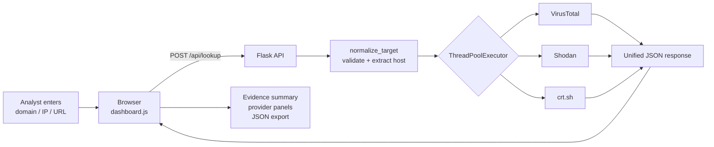
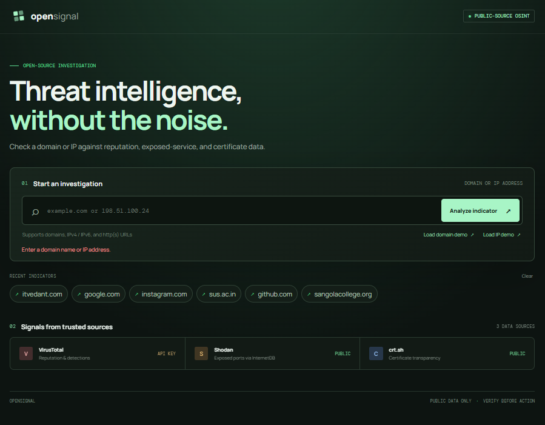
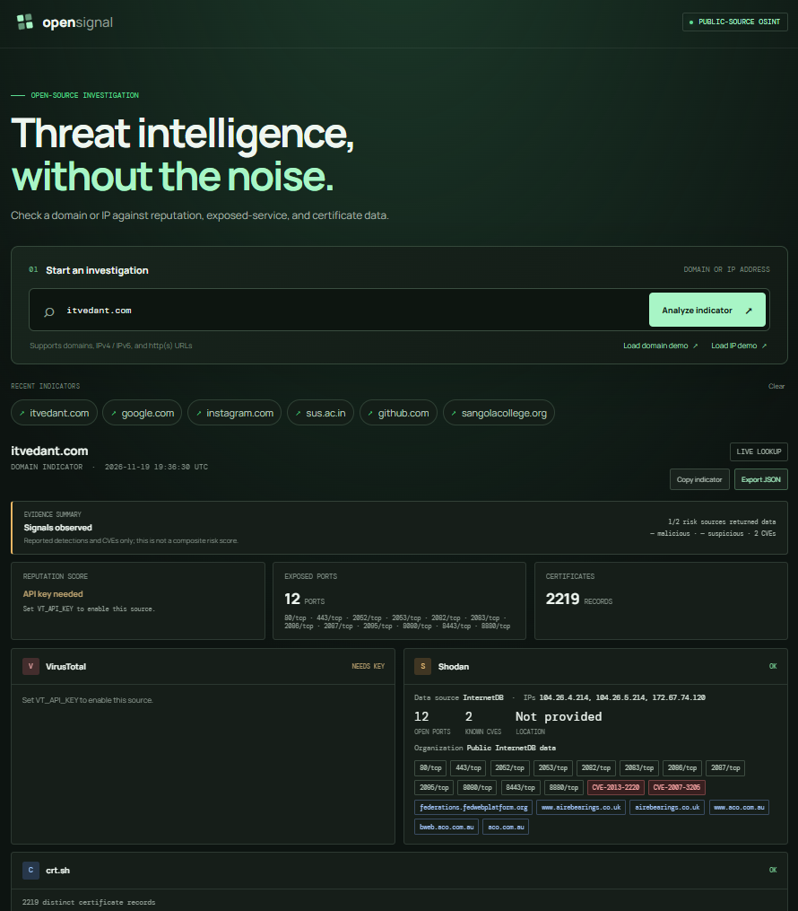

<div align="center">

<!-- Animated cyber-themed header; GitHub loads this SVG from readme-typing-svg.demolab.com. -->


# 🛡️ OpenSignal — Threat Intelligence Dashboard

**🔎 Investigate any domain, IP, or URL across VirusTotal, Shodan, and Certificate Transparency in a single query.**


<br/>

`[ ANALYZE ]` &nbsp; ⚡ &nbsp; ` [ ENRICH ] ` &nbsp; ⚡ &nbsp; `[ REPORT ]`

</div>

---

## 🧭 Overview

OpenSignal is a web-based **threat intelligence enrichment tool** built for the kind of triage a SOC analyst does dozens of times a day: *"Is this indicator suspicious, what is it exposing, and what certificates exist for it?"*

Instead of opening three browser tabs, an analyst submits one indicator (domain, IPv4/IPv6, or `http(s)` URL). The Flask backend normalizes and validates it, queries multiple public intelligence sources **concurrently**, and returns a unified, evidence-based summary in a clean dashboard.

The tool deliberately reports **raw provider evidence** (detections, open ports, CVEs, certificate records) instead of inventing a composite "risk score", because an analyst should see what the data says, not a black-box verdict.

> **Public data only.** OpenSignal never contacts the investigated target directly. It only queries third-party intelligence providers, so analysts do not touch potentially malicious infrastructure.

---

## ✨ Key Features

- **Multi-source enrichment**: VirusTotal (reputation and detections), Shodan (exposed services, CVEs, hostnames), crt.sh (certificate transparency history)
- **Concurrent lookups**: provider queries run in parallel using `ThreadPoolExecutor` with a 9-second per-request timeout
- **Robust indicator parsing**: accepts domains, IPv4/IPv6, and full URLs; extracts the host, handles internationalized domains (IDN/punycode), and validates every hostname label
- **Graceful degradation**: missing API keys, non-applicable indicator types, 404s, and upstream errors each produce a clear status instead of a crash
- **Evidence summary**: shows malicious/suspicious counts and CVEs with an explicit note that it is *not* a composite risk score
- **Analyst workflow helpers**: recent-indicator history (browser-local), one-click copy, and **JSON report export**
- **Demo mode**: preview the full UI with sample data and zero external requests (no API keys needed)
- **Secure by design**: API keys stay server-side in environment variables and are never sent to the browser; all provider data is HTML-escaped before rendering
- **Responsive dark UI**: built with vanilla HTML/CSS/JS, no frontend framework required

---

## 🧰 Tech Stack

| Layer | Technology |
|---|---|
| **Backend** | Python 3, Flask 3.1, `requests` (pooled `Session`), `concurrent.futures`, `ipaddress`, `urllib.parse` |
| **Frontend** | HTML5 (Jinja2 templates), CSS3 (custom properties, grid/flex), Vanilla JavaScript (Fetch API, `localStorage`, Blob API) |
| **Data Sources** | VirusTotal API v3, Shodan API, crt.sh (Certificate Transparency) |
| **Concepts** | REST API design, OSINT, threat intelligence enrichment, input validation, concurrency, secrets management, XSS prevention |

---

## ⚙️ How It Works



1. The browser sends the raw indicator to `POST /api/lookup`.
2. `normalize_target()` extracts the host, converts IDNs to punycode, and classifies it as an IP or a domain. Invalid input returns `400` with a helpful message.
3. Three provider functions run concurrently. Each returns a consistent schema with a `status` field (`ok`, `clear`, `needs_key`, `not_applicable`, `error`).
4. The frontend renders an evidence summary, per-provider panels, and an exportable report.

---

## 🚀 Getting Started

### 📋 Prerequisites

- Python 3.9 or newer
- (Optional) free API keys for [VirusTotal](https://www.virustotal.com/) and [Shodan](https://www.shodan.io/)

### 📦 Installation

```bash
# 1. Clone the repository
git clone https://github.com/<your-username>/opensignal.git
cd opensignal

# 2. Create and activate a virtual environment
python -m venv .venv

# Windows (PowerShell)
.\.venv\Scripts\Activate.ps1
# macOS / Linux
source .venv/bin/activate

# 3. Install dependencies
pip install -r requirements.txt
```

### 🔑 Configuration

API keys are read from environment variables. The app runs without them, and providers without a key simply report `needs_key`. crt.sh is public and needs no key.

```bash
# Windows (PowerShell)
$env:VT_API_KEY = "your-virustotal-key"
$env:SHODAN_API_KEY = "your-shodan-key"

# macOS / Linux
export VT_API_KEY="your-virustotal-key"
export SHODAN_API_KEY="your-shodan-key"
```

### ▶️ Run

```bash
python integrity_checker.py
```

Open **http://127.0.0.1:5000** and click **Load demo data** to preview the dashboard without any API calls.

---

## 🕹️ Usage

### 🧪 From the dashboard

1. Enter an indicator such as `example.com`, `198.51.100.24`, or `https://example.com/login`.
2. Click **Run investigation**.
3. Review the evidence summary and provider panels, then **Copy indicator** or **Export JSON**.

### 🎯 Accepted input

| Input | Normalized to | Type |
|---|---|---|
| `https://Example.com/path?q=1` | `example.com` | domain |
| `198.51.100.24` | `198.51.100.24` | IP |
| `http://[2001:db8::1]:8080/x` | `2001:db8::1` | IP |
| `bücher.de` | `xn--bcher-kva.de` | domain |
| `ftp://x.com`, `bad_host.com`, `localhost` | rejected with `400` | n/a |

### 🔌 REST API

```bash
curl -X POST http://127.0.0.1:5000/api/lookup \
  -H "Content-Type: application/json" \
  -d '{"target": "example.com"}'
```

```json
{
  "target": "example.com",
  "target_type": "domain",
  "checked_at": "2026-10-15T08:12:00+00:00",
  "results": [
    { "provider": "VirusTotal", "status": "ok", "malicious": 0, "suspicious": 0, "harmless": 74, "undetected": 4, "reputation": 0 },
    { "provider": "Shodan", "status": "not_applicable", "message": "Shodan host lookup requires an IP address." },
    { "provider": "crt.sh", "status": "ok", "count": 18, "certificates": [ "..." ] }
  ]
}
```

> Values above are illustrative. A sample exported report is included in [`opensignal-demo.example.net.json`](opensignal-demo.example.net.json).

---

## 🖥️ Screenshots

> Add screenshots to a `docs/` folder and update the paths below.

| Dashboard | Investigation Results |
|---|---|
|  |  |

**Demo:** `docs/demo.gif` *(optional: short screen recording of a lookup and JSON export)*

---

## 📁 Project Structure

```
opensignal/
├── integrity_checker.py                 # Flask app: validation, provider clients, /api/lookup
├── requirements.txt                     # Flask, requests (version-pinned ranges)
├── opensignal-demo.example.net.json     # Sample exported report
├── templates/
│   └── index.html                       # Dashboard layout (Jinja2)
├── static/
│   ├── dashboard.js                     # Fetch, rendering, history, export, demo mode
│   └── style.css                        # Responsive dark theme
└── README.md
```

---

## 🧩 Challenges & Solutions

| Challenge | Solution |
|---|---|
| **Messy analyst input**: URLs, ports, trailing dots, IPv6, and Unicode domains all arrive in the same text box | Built `normalize_target()` using `urllib.parse`, `ipaddress`, and IDNA encoding, plus per-label regex validation and clear error messages |
| **Slow sequential API calls** hurt triage speed | Ran providers concurrently with `ThreadPoolExecutor` and a shared `requests.Session`, with a bounded timeout so one slow source cannot stall the page |
| **Inconsistent providers**: different auth, response shapes, and failure modes | Normalized every provider to one response schema with explicit statuses (`ok`, `clear`, `needs_key`, `not_applicable`, `error`) so the UI never has to guess |
| **Rendering third-party data safely** (XSS risk from certificate names, hostnames, etc.) | Escaped all external values through a dedicated `escapeHtml()` helper before inserting into the DOM |
| **Avoiding misleading verdicts** | Showed raw detections and CVEs with an explicit "not a composite risk score" note, so analysts keep decision authority |
| **Protecting secrets** | Loaded keys from environment variables server-side only; the browser never sees them |

---

## 🧠 Skills Demonstrated

- **Security / SOC:** OSINT, threat intelligence enrichment, indicator of compromise (IOC) triage, certificate transparency analysis, understanding of exposed services and CVE data
- **Backend:** Python, Flask, REST API design, third-party API integration, concurrency, error handling, input validation
- **Frontend:** JavaScript (ES6), DOM rendering, Fetch API, responsive CSS, accessibility basics (ARIA live regions, labels, `role="alert"`)
- **Secure development:** secrets management, output encoding (XSS prevention), least-exposure design (no direct target contact), safe defaults (`debug` off unless explicitly enabled)
- **Engineering practice:** graceful degradation, consistent data contracts, separation of concerns, documentation

---

## 📈 Impact Highlights

- Consolidated **3 intelligence sources** into a **single-query workflow**, removing the need to pivot between separate tools during triage
- Reduced total lookup time to roughly the slowest provider's response by running requests **in parallel**
- Designed a **fault-tolerant API** that returns a usable result even when providers are unavailable, unconfigured, or not applicable to the indicator type
- Enforced **security-by-design**: server-side secrets, HTML-escaped output, and no direct contact with investigated infrastructure
- Delivered an **analyst-ready UI** with demo mode, search history, clipboard copy, and exportable JSON reports

---

## 🔐 Security Considerations

This project is intended for local and learning use. Before exposing it to a network:

- Run it behind a production WSGI server (e.g., Gunicorn or Waitress), not the Flask development server
- Add authentication and rate limiting to protect your API quotas
- Serve over HTTPS and keep `FLASK_DEBUG` unset (default is off)
- Treat provider results as one input among many and verify before acting

---

## 🗺️ Roadmap

- [ ] Automated tests (`pytest`) for `normalize_target()` and provider handlers with mocked responses
- [ ] Additional sources: AbuseIPDB, URLhaus, AlienVault OTX, WHOIS/passive DNS
- [ ] Response caching (e.g., TTL cache) to conserve API quotas
- [ ] Rate limiting and optional authentication
- [ ] Dockerfile and `docker-compose.yml` for one-command setup
- [ ] CI pipeline (GitHub Actions) with linting and tests
- [ ] Bulk indicator upload (CSV) and MITRE ATT&CK-oriented context
- [ ] Persistent investigation history

---

## 🤝 Contributing

Contributions, issues, and feature ideas are welcome.

1. Fork the repository
2. Create a feature branch: `git checkout -b feature/your-feature`
3. Commit with a clear message: `git commit -m "Add: short description"`
4. Push the branch: `git push origin feature/your-feature`
5. Open a Pull Request describing what changed and why

Please keep changes focused, follow the existing code style, and never commit API keys.

---

## 📜 License

Distributed under the **MIT License**. Add a `LICENSE` file to the repository root before publishing.

---

## 👨‍💻 Author

**Vishvajit Madavan** — BCA student | Aspiring SOC & Web Security Analyst

[GitHub](https://github.com/visshh05) · [LinkedIn](https://www.linkedin.com/in/vishavajit-madavan-a3abb832a) · [Email](mailto:vishavajitmadavan15@gmail.com)

---

<div align="center">


`01001111 01010000 01000101 01001110 01010011 01001001 01000111 01001110 01000001 01001100`

</div>

<div align="center">

*Built for learning and defensive security. Use responsibly and only on indicators you are authorized to investigate.*

</div>
